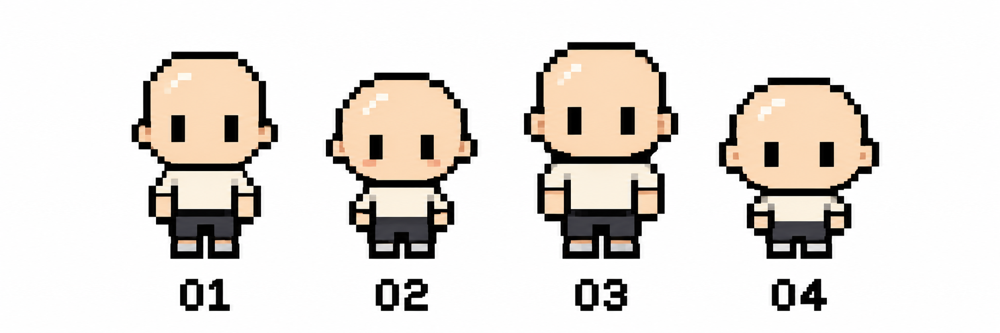
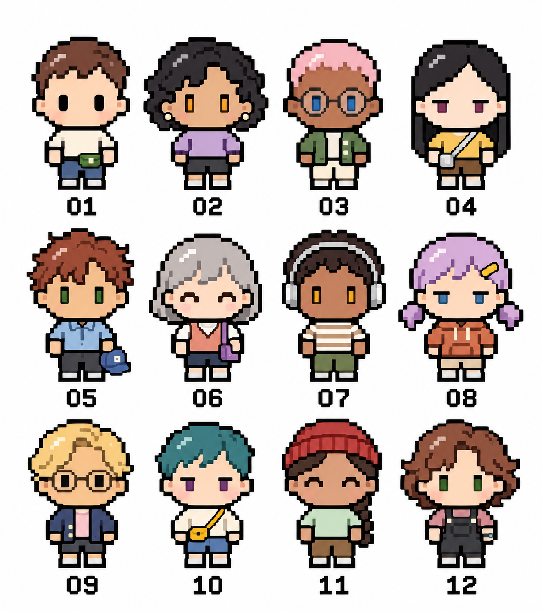
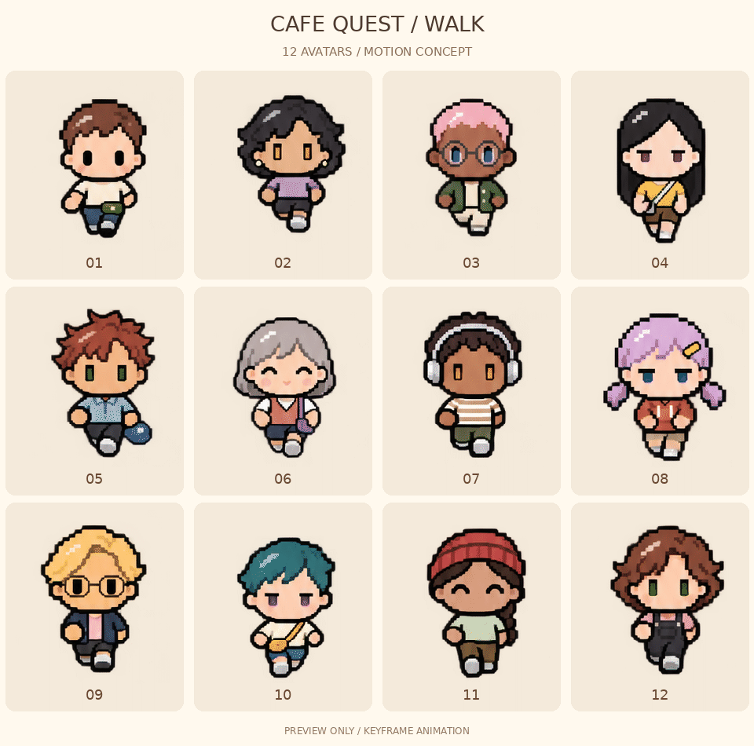

# Cafe Quest 캐릭터 · 모션 시안

현재 선택된 캐릭터 방향과 12종 × 8개 동작을 검토하기 위한 **디자인 시안 보관본**입니다. 게임 런타임에 적용한 스프라이트가 아닙니다. 기존 앱 코드 및 PRD는 변경하지 않습니다.

## 선택한 기본형

아래 4안 중 **02번**이 기준입니다. 사람 형태가 명확한 둥근 머리와 작은 몸, 분리된 팔·다리, 단순한 눈과 절제된 명암을 사용합니다. 외계인처럼 보이는 과도한 단순화 대신, 가볍고 투박한 도트 인상을 지향합니다.

## 꾸미기 12종

직업이나 테마를 강제하지 않고 피부색, 머리 모양·색, 일상복, 안경·헤드폰·가방, 렌즈 같은 눈 색과 표정을 다양화합니다. 번호는 시안 식별자이며 캐릭터 직업이나 고정 성격을 의미하지 않습니다.

## 동작 미리보기

각 GIF는 12종을 4열 × 3행으로 배치한 4프레임 루프입니다. 이전 미리보기에서 일부 캐릭터가 왼쪽으로 밀리는 문제를 보정한 `aligned` 버전만 포함합니다. 걷기는 제자리 동작이며 월드 좌표 이동은 게임 로직에서 별도로 처리해야 합니다.

| 동작 | 용도 | 미리보기 |
| --- | --- | --- |
| 걷기 | 카페 이동 | [GIF](motions/01-walk-aligned.gif) |
| 대기 | 서서 쉬기 | [GIF](motions/02-idle-aligned.gif) |
| 인사 | 다른 사람과 만나기 | [GIF](motions/03-wave-aligned.gif) |
| 마시기 | 음료와 상호작용 | [GIF](motions/04-drink-aligned.gif) |
| 살펴보기 | 메뉴·소품 확인 | [GIF](motions/05-inspect-aligned.gif) |
| 앉기 | 좌석 이용 | [GIF](motions/06-sit-aligned.gif) |
| 기뻐하기 | 보상·성공 반응 | [GIF](motions/07-happy-aligned.gif) |
| 꾸미기 반응 | 착장 확인 제스처 | [GIF](motions/08-dress-up-aligned.gif) |

## 제작 출처와 한계

- 이번 대화에서 생성한 AI 캐릭터 이미지와 이를 기반으로 만든 모션 미리보기입니다. 사용자 제공 제3자 참고 이미지는 재배포하지 않습니다.
- 흰 배경과 번호가 포함된 검토용 판입니다. 투명 배경의 개별 캐릭터, 스프라이트 아틀라스, 레이어별 원본은 아닙니다.
- 좌우 정렬 보정은 캐릭터가 밀리는 현상을 줄인 것이지, 모든 픽셀의 일관성을 보증하는 최종 리터칭이 아닙니다. 프레임 사이 윤곽·눈·옷·소품에 흔들림이 남을 수 있습니다.
- 앉기에서 의자 형태와 등장 여부 등 소품 일관성을 추가 수정해야 합니다. 꾸미기 반응은 실제 의상 교체 기능이 아닙니다.
- 8가지 동작 컨셉을 보여 주며 모든 방향의 이동·상호작용이나 완전한 360도 스프라이트 세트를 제공하지 않습니다.
- 프레임 크기·해시·파일 크기는 [manifest.json](manifest.json)에 기록했습니다. GIF 8개의 모든 프레임을 디코딩해 파일 손상 여부를 확인했습니다. 게임 내 동작 검증과는 별개입니다.

## 실제 구현 전 다음 단계

1. 기본 몸체의 픽셀 해상도, 팔·다리 비율, 팔레트와 발 기준점을 확정합니다.
2. 몸체·눈·머리·옷·액세서리를 분리하고 동작별 장착점을 정의합니다. 12종 × 모든 조합을 각각 완성 파일로 만드는 대신 공통 동작 위에 부품을 합성하는 방향을 권장합니다.
3. 앉기·마시기 소품과 전후 가림 순서를 정리하고 필요한 방향별 프레임을 직접 정제합니다.
4. 캐릭터 크기와 픽셀 비율을 카페 맵에서 확인한 뒤 투명 아틀라스, 프레임 타이밍, 충돌 영역을 제작합니다.
5. 실제 입력과 상태 전이, 장착물 누락, 제자리 루프의 좌표 이동, 모바일 가독성을 검증합니다.

이 PR은 시안 보관·검토만 다루며 카페 맵과 게임 기능 구현, 공개 배포는 포함하지 않습니다.
